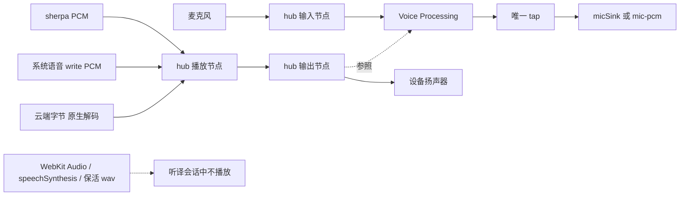

# 统一原生音频引擎 + 系统回声消除（第 6 轮方案）

日期：2026-10-15。这一份只写方案。不改代码，不推送，不提审，不动线上中继。

用户 2026-10-12 已同意的方向，本方案照此展开，不再把方向本身列成待定：

- 所有朗读（云端、sherpa、系统语音）和收音进同一台原生音频引擎。WebKit 只管界面，不出声。
- 打开系统回声消除。参照是 App 自己的朗读声。
- 打开之后撤掉静麦和同语言丢弃两道硬拦。疑似回声留成能恢复的灰行。对方插话时停掉当前这一句朗读。退回静麦的开关只放在内部诊断里。
- 测回声时可以临时改音量，测完还原。用户 Mac 平时音量 80 且静音。
- 先在 Mac 上试做 2 天。过不了关就改用 App 内置的 WebRTC AEC3。

## 0. 所依据的规约

| 规约 | 用在本方案的哪一条 |
|---|---|
| BAN-39，`AGENTS.md` 557–564；摘要 `docs/conventions-digest.md` 226 | 凡 Apple / WebRTC 接口，先查官方文档，在 issue 贴页面、链接、适用平台、日期和预期。文档没写的写成「待确认」，不靠试字段。 |
| 领域设计先过人评审再改代码，`AGENTS.md`「Domain design」；听译管线在 `docs/learning-design.md` §9.6，采集边界在 `docs/domain-design.md` 384–392 | 本文件不是那次评审。第 1 阶段写代码之前，要先改 §9.6 并等人签过。 |
| 交互稿先行，`AGENTS.md` 149–155；PEN-15 / PEN-16，`docs/conventions-digest.md` 89–90 | 灰行是用户能看见的界面，实现前要有 Pencil 稿和人的签字。内部诊断里的「退回静麦」开关按 PEN-15 豁免。 |
| 音频改动先过 Mac 版 App，`docs/verification-spec.md` 475–481 | 两天试做就在 Mac 上。iPhone 真机不进这两天。 |
| 不调阈值 | `ECHO_SIM`、`ECHO_TAIL_MS`、`ECHO_PLAY_MAX_MS` 以及识别门限保持现状。过关标准是「不比 1.19.3 基线差」，不是再调一档。 |
| 中国版与国际版共用同一份原生源，`scripts/sync-app-assets.js` 388、393–405 | 开关默认关。关着时两版行为与今天相同。不按 flavor 分叉音频路径。 |
| 并行 session 各用一棵工作树，`AGENTS.md` | 本方案写在 `cursor/feat-592-unified-subs` 这棵树。不切 `main`，不切 `release/1.19.0`。 |
| 采集是汇不是源，BAN-30 | 回声闸只决定听译收不收这一句。它不反向改翻译引擎。 |

## 1. 现状（只读，行号取自本分支）

本分支上这几份音频文件最后一次改动是 `41299ced`。下面的行号是 2026-10-15 在这棵树上读到的，不是 `main`，也不是 `docs/status/r5/echo-aec-proposal.md` 里的旧行号。那份 r5 方案的产品结论已被 2026-10-12 的方向取代；它的 ERLE 数字本方案不沿用。

当前代码里没有 `setVoiceProcessingEnabled`。全库检索无命中。

### 1.1 朗读和收音各走哪条路

现在有三台彼此独立的 `AVAudioEngine`，另外还有两条由 WebKit 出声的路。收音引擎不播放。两台朗读引擎各自播放，不收音。

| 路 | 谁出声 / 谁收音 | 位置 |
|---|---|---|
| 收音 | `MTAudioBridge.micEngine`。`inputNode` 装一个 tap，回调 `micDeliver`。本机转写走 `micSink`；云端转写把 PCM 送进 JS。 | `app/native/audio-bridge.swift` 164、284–326、314–316、332 |
| sherpa（Kokoro / vits） | `MTDeviceSpeech` 自己 `AVAudioEngine()` + `AVAudioPlayerNode`。首块出声时把静麦置上，播完置下。 | `app/native/speech-bridge.swift` 701、718、851、906、918–922、940–954 |
| 系统语音（原生） | `MTSystemSpeech`。`AVSpeechSynthesizer.write` 交出 PCM，再进**另一台**自建引擎。 | 同文件 972、977、1013、1028–1045、1082–1092 |
| 云端 / 自建朗读 | JS `new Audio(data:…)`，WebKit 播放。不置静麦。 | `extension/learn/tts.js` 585、698–724 |
| 系统语音的 WebKit 退路 | App 里先试原生 `systemVoice`；桥不在、该语言无原生声、或原生开口失败时，`speechSynthesis.speak`。 | 同文件 617–630、676 |
| 听译保活 | iOS 上、桥会挂起时，开麦前用 WebKit 循环播放一段 wav，为的是把音频会话类别固定住。实时字幕不播这段。 | `src/app/listen-model.js` 1912–1924 |

调用关系：

- `speakImpl` 按引擎类型分流：`device-speech` → 原生；`browser` → `speakBrowser`；其余 → `speakBytes`（`extension/learn/tts.js` 555–585）。
- 原生一句由 `NativeSpeech.speak` 发 `{type:'tts-speak'}`（`app/native-speech.js` 463–475）。
- `stop()` 同时掐原生、`speechSynthesis` 和当前的 `Audio` 元素（`extension/learn/tts.js` 529–542）。

平台差异（现状）：

- iOS 开麦时把 `AVAudioSession` 设成 `.playAndRecord`（`audio-bridge.swift` 285–296）。两台朗读引擎只 `setActive(true)`，不改类别（`speech-bridge.swift` 943–946、1021–1024）。
- macOS 没有 `AVAudioSession`。开麦走同一份 `micBegin`，从 297 行起的 `AVAudioEngine()` 两平台共用。
- Mac 实时字幕另有一条系统声音采集：`CATapDescription(stereoGlobalTapButExcludeProcesses:)`，排除本进程，降混后送进同一个 `micDeliver`（`audio-bridge.swift` 1027–1034、952）。这条听的是别的 App 的声音。听译对话不走它。

扩展与中国版：

- 扩展没有这套 Swift。朗读只有 `speechSynthesis` 和 `new Audio`。`docs/domain-design.md` 384–392：扩展不获得麦克风源。本方案不改扩展。
- `scripts/sync-app-assets.js` 388 行写明锚点在两个 flavor、两个平台上相同；393–405 行把同一份 `audio-bridge.swift` 和 `speech-bridge.swift` 灌进生成的 Xcode 工程。中国版 App 与国际版 App 共用这两份源，没有第二套音频引擎。

### 1.2 两道硬拦，以及现在靠什么判断回声

**静麦。** `muteInput` 为真，或刚放开后的 350 ms 内，`micDeliver` 交给识别器的是同长度的零帧，tap 不停（`audio-bridge.swift` 176–181、332–338）。置位的只有两条原生朗读路：sherpa 首块（`speech-bridge.swift` 906）和系统语音首块（1045）。收尾置回 false（920、936、1035、1076）。云端 `new Audio` 和 `speechSynthesis` 不碰这个开关。

**同语言丢弃。** 播放进行中的语言集合来自 `playingLangs`：`to == 0` 且未超过 `ECHO_PLAY_MAX_MS`（15 s）的登记项（`app/listen-core.js` 218、276–288）。`intakeDecide` 的第一支：定稿语言命中这个集合就丢，原因 `speaking`（1168–1173）。半句同样丢（`src/app/listen-model.js` 1584–1587）。转交进目标通道之前再查一次（`app/listen-core.js` 1515–1523，诊断 `xfer-echo` / `speaking`）。

**文字回声。** `makeEchoGuard`（257）。`speaking` 登记文本（263），`spoke` 记下播完时刻（271）。`isEcho` 用 token 包含度，门限 `ECHO_SIM = 0.35`，播完后再看 `ECHO_TAIL_MS = 3000`（206–211、291–301）。`intakeDecide` 第三支命中则丢，原因 `echo`（1180）。转交路径同样再查（1524–1527）。`speakPump` 在开口时 `echo.speaking`，在 `done` 之后 `echo.spoke`（`src/app/listen-model.js` 2602、2616）。

注释里写明为什么同语言闸比文字闸硬：2026-10-06 的 95/96 号包上，扬声器回声的识别劣化到 0.35 的包含度拦不住（`app/listen-core.js` 276–280）。本方案不改这三个常数。

### 1.3 哪些路径要收进同一台引擎

| 路径 | iOS App | Mac App | 扩展 | 中国版 |
|---|---|---|---|---|
| 听译麦克风 tap | 要收 | 要收 | 无此路径 | 与国际版同一份源 |
| sherpa 播放 | 要收 | 要收 | 无 | 同上 |
| 原生系统语音播放 | 要收 | 要收 | 无 | 同上 |
| 云端字节播放 | 要收（今天在 WebKit） | 要收 | 留在 WebKit，本方案不改 | App 侧随开关；扩展不改 |
| `speechSynthesis` 退路 | 听译会话里不再出声 | 同左 | 留着 | 同左 |
| iOS 保活 wav | 要离开 WebKit | `NativeAudio.suspends()` 为假时今天不播（1918） | 无 | 同国际版 |
| Mac 系统声音字幕 tap | 无 | **不收进这台朗读引擎**。它排除本进程，听的是别的 App | 无 | 同国际版 |

### 1.4 已有测试和基线

逻辑闸（注入文本，不经过空气）：

- `test/app-listen.test.js`：`makeEchoGuard` 的包含度、尾巴、`playingLangs`。
- `test/listen-ea.test.js`：`intakeDecide` 的 `speaking` / `echo`。
- `test/listen-r5.test.js`：转交前的 `xfer-echo`。
- `test/build-scripts.test.js`：两处 `muteInput = true` 必须还在。实现阶段若在开关打开时不再置静麦，这道门要改成「开关关闭时仍置位」，而不是删掉断言。

Mac 自检 `scripts/test-mac.js`：

- 21–22、277–284 行：听译组把系统输出静音，测完还原。注释写明不静音的话麦克风会真听到朗读，那是 M3 的物理版，另案。
- M3（536 行起）是注入版：把念过的文本喂回麦克风事件，期待闸拦住。它不证明空气里的回声被消掉。
- M4 期待另一句在排空后被收下。

`docs/verification-spec.md` 1897–1901：本仓库自己的尖刺——`setVoiceProcessingEnabled(true)` 装在已经挂了 playerNode 的 engine 上时，tap 收 0 帧（两次）；不挂 player 时能收帧。不开 VP 时扬声器到麦克风的回声约 +7 dB，播放中采集不掉帧。这是我们的读数，不是 Apple 文档里的句子。

**基线文件。** 任务指定的 2026-10-11 1.19.3 基线路径是机器上的 `/workspace/baseline/release-baseline-1.19.3.md`。2026-10-15 在这台机器上读，**读不到**。仓库里的 `docs/release-baseline-1.19.3.md` 是另一份文件，本方案不用它填任何回声、丢词或重复的数字。

## 2. 反复出现的回声问题

### 2.1 现象

听译把译文朗读出去之后，麦克风又把这句收回来，收成新的一行，再翻译、再朗读。2026-09-13 的一场里 43 句有 6 句是自己的译文（`docs/learning-design.md` 3236–3238）。2026-10-05 / 10-06 的几轮里，系统语音和泰语仍会出现「念完又多一行」（`app/listen-core.js` 207–215、276–280；issue #565、#572）。

### 2.2 根因

三台引擎拆开，加上 WebKit 自己播放，系统回声消除没有一个稳定的参照：

1. 云端 `new Audio` 和 `speechSynthesis` 不置静麦，朗读声原样进识别器。
2. 静麦只盖住两条原生路，而且是把**所有人**的声音换成零帧。对方在这句朗读期间插话，识别器收到的是静音。
3. 同语言硬丢用「正在播这门语言」代替声学判断。对方用同一门语言插话，会被整句丢掉。文字包含度在扬声器回声上又经常对不上（0.35 仍漏）。
4. 本仓库尖刺：在已经挂了播放节点的引擎上打开 Voice Processing，tap 曾收到 0 帧。所以今天的出货路径把 VP 关着，用静麦顶上（issue #352 把这件事记成「先别做」）。2026-10-12 的方向是把播放和收音放进同一台引擎后再开 VP，而不是在现有三台引擎上直接开。

### 2.3 统一引擎怎么解

一台 `AVAudioEngine` 同时持有输入 tap 和播放节点。sherpa 的 PCM、系统语音 `write()` 的 PCM、云端解码后的 PCM，都排进这台引擎的播放节点。引擎处于停止状态时打开 `setVoiceProcessingEnabled(true)`。WebKit 在听译会话期间不再 `new Audio`、不再 `speechSynthesis.speak`、不再播保活 wav。

VP 打开并且参照就是这台引擎播出去的声音之后，才撤两道硬拦：静麦不再把帧置零；`intakeDecide` 的 `speaking` 支和半句上的同语言丢弃不再丢句。文字相似度改成给行打「疑似回声」标记，行留下、可恢复，不翻译、不朗读、不进语料，直到用户恢复。对方的一句（标记没打上）在播放中到达时，停掉**当前正在念的那一句**。

### 2.4 代价

- 听译会话里，扩展仍然用 WebKit 出声；App 不再用。云端字节要在原生解码后再排进播放节点，多一次桥消息。
- 灰行是新的用户可见状态，要先有 Pencil 稿（窄 / 宽·iPad / 宽·Mac）。稿子排在 Mac 声学尖刺通过之后；尖刺失败就不出这张稿。
- 撤掉静麦之后，插话能被听到，回声也重新有机会进识别器。灰行是兜底，不是另一道硬拦。
- AEC3 是第二条实现。它要把参照 PCM 和麦克风 PCM 按 WebRTC 头文件里的延迟公式对齐，并引入一份 C++ 源。那是 VP 没过关之后的事，不在这两天里落地。
- 保活 wav 今天用来防止 WebKit 把会话类别改回 `.playback`（`listen-model.js` 1912–1914）。WebKit 不再出声之后，这层是否还要，文档没有写，见第 9 节。

### 2.5 风险

- 头文件写的是「消掉当时从设备播出的声音」。它没有点名「另一台 AVAudioEngine」或「WebKit 进程」。设计不依赖那两种声音也会被消掉，所以把三路朗读都放进打开了 VP 的那一台。
- 我们自己的尖刺是 0 帧。若同一台引擎、按头文件顺序打开之后 tap 仍是恒 0，VP 这条不过关，转 AEC3。不再改调用顺序碰运气。
- `.mixWithOthers` 在打开 VP 之后还在不在，Apple 文档没有写。issue #352 的既有裁定：读回发现掉了，当场停这条路线。
- 基线文件读不到。两天里可以记读数，不能宣告「不比基线差」。

## 3. 引擎设计

### 3.1 模块边界

新增一个原生单例（名字实现时再定，下文称 hub）。它拥有唯一一台听译用的 `AVAudioEngine`。

| 模块 | 职责 | 不做什么 |
|---|---|---|
| hub | 创建引擎；停止时开关 VP；安装唯一的输入 tap；提供一个播放节点；把各来源的 PCM 转成该节点的格式再排程；报告播放开始 / 结束 | 不识别、不翻译、不决定哪一行是回声 |
| `MTAudioBridge` | 会话类别、权限、`micDeliver` 之后的去向（`micSink` / `mic-pcm` / 电平）。Mac 系统声音 tap 仍由它持有，不并进 hub 的播放图 | 开关关闭时，保持今天的 `micEngine` |
| `MTDeviceSpeech` / `MTSystemSpeech` | 合成 PCM。开关打开时向 hub 要播放节点，不再 `AVAudioEngine()` | 不第二套 tap |
| JS `tts.js` | 开关打开且在 App 内：云端字节发给原生播放；听译会话里不走 `speechSynthesis` 和 `new Audio`。开关关闭：与今天相同 | 扩展里的行为不变 |
| `listen-core.js` 回声闸 | 开关打开时：`speaking` 硬丢改为标记；`isEcho` 改为灰行标记，常数不改。开关关闭：今天的硬丢 | 不新增门限 |
| 内部诊断 | 一个「退回静麦」开关，默认关。只有它能在 VP 开着时把 `muteInput` 再置上 | 不出现在设置页 |

开关默认关。关时 hub 不创建，三台引擎和两道硬拦与今天相同。这是回滚点。

### 3.2 数据流

Mac 系统声音字幕的进程 tap 不画在这张图里。它继续排除本进程，直接进现有的 `micDeliver`。

### 3.3 参照信号怎么取

按头文件讨论（第 4 节）：打开 VP 之后，输入节点去掉「当时从设备播出的声音」。实现上，参照就是这台 hub 的输出节点正在送给设备的那一路。sherpa、系统语音、云端解码结果都先变成播放节点上的 buffer，再由这台引擎播出去。

不把下面两样当作参照来源：

- WebKit 的 `new Audio`、`speechSynthesis`、保活 wav。听译会话里它们不播放。
- Mac 字幕用的系统 tap。那条是输入，不是我们的播放。

### 3.4 延迟预算

Apple 头文件给出 `presentationLatency`（硬件延迟，对应 `kAudioDevicePropertyLatency` 与 `kAudioStreamPropertyLatency`），没有给出毫秒上限。VP 这条路径不向系统提交延迟参数。

WebRTC AEC3 的延迟是调用方必须设置的，公式见第 4 节。数字等试做量到再填。试做前不写死毫秒，也不把 r5 方案里的 ERLE 门限拿来当预算。

两天里要记下的数：`presentationLatency`、从播放节点排入一块到麦克风 tap 看到对应能量的时间差、以及这块时间差在一句朗读里的范围。只记录，不设「超过多少毫秒就失败」。失败条件是第 5 节的帧、回声行、丢词和重复，不是一个预先写死的延迟。

### 3.5 播放中打断

对方插话 = 播放进行中到达一条定稿，且灰行标记没有打上。

行为：

1. 停掉当前这一句（现有 `LearnTTS.stop` / 原生 `stop`，播放节点清空当前排程）。
2. 这一句不再续播。`echo.spoke` 以停播时刻记 `to`，避免「还在播」的集合一直占着这门语言。
3. 新句进入现有队列，按队列念。
4. 队列里还没开口的后续句：本方案暂定接着念。这一点列在第 7 节，等人确认是不是要整段清掉。

疑似回声的灰行不触发打断。

### 3.6 三个来源怎么接

| 来源 | 接入 | 播放开始 / 结束 |
|---|---|---|
| sherpa | 现有回调已经交出 float 样本（`speech-bridge.swift` 908–912）。改为排进 hub 的播放节点。采样率与 hub 不一致时在排入前转换。 | 仍发 `tts-start` / `tts-end`。开始对齐第一块真正排入，结束对齐播完，沿用 `MTSpeechChunkBox` 的「首块 + 样本数 / 采样率」 |
| 系统语音 | `write()` 的 PCM（1031）同样排进 hub。不再为它 `AVAudioEngine()` | 协议不变 |
| 云端 | JS 把字节交给原生（新的桥消息，实现时再命名）。原生解码后排进同一个播放节点。App 内听译不再 `new Audio` | 同一对 `tts-start` / `tts-end`，`speakBytes` 的 `done` 改等这对事件 |

听译会话里原生系统语音失败时，不再落到 `speechSynthesis`。失败保持今天的具名理由（`tts-failed`），让用户知道，不静默（BAN-23）。

### 3.7 iOS 与 Mac

| | Mac（两天试做） | iOS（试做通过之后，另需批准） |
|---|---|---|
| 引擎 | 一台 `AVAudioEngine`，渲染到音频设备 | 同一台。类别仍是 `.playAndRecord` |
| 会话 | 无 `AVAudioSession` | hub 创建前由 `MTAudioBridge` 钉类别。不在朗读引擎里另设一套 |
| VP | 引擎停止时 `inputNode.setVoiceProcessingEnabled(true)`。头文件写明任一侧打开，另一侧跟着打开 | 同一调用。可用性 macOS 10.15 / iOS 13.0，高于本仓库下限 macOS 13.3 / iOS 16.4 |
| 格式 | 输入节点输出格式与输出节点输入格式必须相同，且只能在引擎停止时改 | 同左 |
| 字幕系统 tap | 保持排除本进程，不并进 hub | 无此 tap |
| 声学验收 | 真扬声器 + 真麦克风。临时取消静音 | 模拟器麦克风是 0 字节（`docs/verification-spec.md` 821 行附近）。声学只在真机 |

## 4. 官方文档依据和预期

查阅日期一律 2026-10-15。

| 依据 | 页面 / 位置 | 链接 | 适用平台 | 文档写了什么 | 本方案的预期 |
|---|---|---|---|---|---|
| `setVoiceProcessingEnabled:error:` | MacOSX27.0.sdk 与 iPhoneOS27.0.sdk 的 `AVFAudio.framework/Headers/AVAudioIONode.h` 141–164 行 | 系统 SDK 头文件；网页入口 <https://developer.apple.com/documentation/avfaudio/avaudioionode/setvoiceprocessingenabled(_:)>（同日网页 Discussion 区是空的，以 SDK 头文件为准） | `API_AVAILABLE(macos(10.15), ios(13.0), watchos(6.0), tvos(13.0))` | 打开后，输入节点去掉当时从设备播出的声音。任一侧打开，另一侧跟着打开。只在渲染到音频设备时可用，手动渲染模式不行。只能在引擎停止时开关。输入节点的输出格式与输出节点的输入格式必须相同，且只能在停止时改。 | 试做按这个顺序：引擎停着 → 打开 VP → 再读格式、装 tap、连接播放节点 → `start`。成功时 `isVoiceProcessingEnabled == true`，且播放期间 tap 不是恒 0。失败时带头文件的 error，不换一套未记载的参数重试。 |
| `presentationLatency` | 同一头文件 115–123 行 | 同上 | 该属性随 `AVAudioIONode`，`API_AVAILABLE(macos(10.10), ios(8.0), …)` | 渲染到音频设备时的硬件延迟，对应两个 Core Audio latency 属性。 | 试做读取并记录。不把它换成一个自定毫秒门限。 |
| WWDC19 session 510 | What's New in AVAudioEngine，转录 | <https://developer.apple.com/videos/play/wwdc2019/510/> | 场次讲 AVAudioEngine；转录没有单独写「仅 iOS」 | 用途是回声消除和 VoIP。打开后做额外处理，并去掉来自设备的声音。输入和输出节点都要处于该模式。不能在引擎运行中动态打开。 | 与头文件同一预期。场次里的 AV Echo Touch 示例只作索引，不把示例工程里的未引用段落写进方案。 |
| WWDC23 session 10235 | What's new in voice processing，转录 | <https://developer.apple.com/videos/play/wwdc2023/10235/> | 语音处理 API；静音说话检测写明 macOS 14 / tvOS 17（那是另一条 API） | 能力含回声消除、噪声抑制、自动增益。两条入口：AUVoiceIO / AUVoiceProcessingIO，或 `AVAudioEngine` 的 voice processing 模式，能力相同。示例是先 `inputNode.setVoiceProcessingEnabled(true)`。不经该 API 渲染的本 App 另一路播放、以及其他 App 的播放，被称作 other audio，并被压低。 | 三路朗读都经这台已打开 VP 的引擎播出，使它们落在「voice 那一路」而不是 other audio。不使用 ducking 配置去补偿参照。静音说话检测不在本方案范围内。 |
| WebRTC `AudioProcessing` | `api/audio/audio_processing.h`，main，2026-10-15 读取 | <https://webrtc.googlesource.com/src/+/refs/heads/main/api/audio/audio_processing.h> | 库本身，不区分 iOS / Mac | `echo_canceller.enabled`。远场帧进 `ProcessReverseStream`，近场帧进 `ProcessStream`。`set_stream_delay_ms` 是远场帧被 `ProcessReverseStream` 收到、到含对应回声的近场帧被 `ProcessStream` 收到之间的毫秒。客户端公式：`delay = (t_render - t_analyze) + (t_process - t_capture)`。 | 仅当 VP 两天不过关时才走。延迟用这个公式现量，不先填常数。 |
| WebRTC `EchoCanceller3` | `modules/audio_processing/aec3/echo_canceller3.h`，main，同日 | <https://webrtc.googlesource.com/src/+/refs/heads/main/modules/audio_processing/aec3/echo_canceller3.h> | 同上 | `AnalyzeRender` 保存渲染（扬声器）信号；`ProcessCapture` 从采集信号里去掉回声。 | 参照取 hub 播放节点送出去的 PCM，采集取 tap 的 PCM。不在 VP 还没判失败时把这份源编进来。 |

网页版符号页的 Discussion 在 2026-10-15 是空的。上表「文档写了什么」里关于 VP 行为的句子，来自同日 SDK 头文件 150–162 行，不来自网页摘要。

### 4.1 Voice Processing 与 AEC3 怎么取舍

先做 VP，并且只做头文件写明的那一种接法。两天结束时用数据判，不改 `ECHO_SIM` 等常数。

过关（四条都要成立）：

1. 播放期间输入 tap 的帧不是恒 0，外部人声的定稿仍到达。这是相对本仓库 0 帧尖刺的否证。
2. 回声行数不高于 1.19.3 基线。基线文件读不到，这条在文件可读之前不能打勾。
3. 丢词数不高于基线。同上。
4. 重复（同一句被再收成一行，或被再朗读）不高于基线。同上。

任一一条在基线可读之后更差，或者第 1 条在 Mac 上就是恒 0：VP 不过关，停手，改做 AEC3。AEC3 用同一套四条，仍然不调阈值。AEC3 的延迟若只能靠填一个文档里没有的常数才能跑，停在第 9 节，不填。

issue #352 把 VP 记成「等尖刺、现在不做」，前提是静麦常开所以回声问题不存在。2026-10-12 的方向改了这个前提。#352 的另一条仍然有效：若读回 `.mixWithOthers` 掉了，停 VP 这条，不改选项碰运气。文档没有写 VP 与 `.mixWithOthers` 的关系，所以「会不会掉」是待确认；「掉了就停」是我们自己的停手条件。

## 5. 两天 Mac 验收

范围：用户的 Mac，Debug 包，内部开关。不装到 TestFlight，不跑 iPhone。`docs/verification-spec.md` 475–481：音频链路先在 Mac 版过，才谈真机包。这两天只做 Mac。

音量：开始前用系统读回输出音量和静音状态。若不是音量 80 且静音，停下来问，不自行改到 80。试做时临时取消静音；音量只在试做窗口内改。每个用例结束、以及异常退出时，写回试做前读到的值。判据是再读一次，确认与试做前一致。不改 Mac 代理，不调用改代理的命令。

开关关闭的对照组仍走今天的 `test:mac`（输出保持静音）。那一组证明旧路径还在，不证明回声。

### 5.1 用例

| # | 做什么 | 通过 | 要不要人批准 |
|---|---|---|---|
| A0 | 开关关。现有 M2–M5，输出保持静音 | 与今天的注入判据一致 | 否。不取消静音 |
| A1 | 开关开，按第 4 节顺序开 VP。App 不朗读，`say` 一句进麦克风 | tap 非恒 0；定稿到达；`isVoiceProcessingEnabled` 为真 | 要。取消静音 |
| A2 | 开关开。App 用 sherpa 念一句，扬声器开着，麦克风开着 | 记下被收成新行的条数。基线可读之后，条数不高于基线 | 要 |
| A3 | 同 A2，换成原生系统语音 | 同 A2 | 要 |
| A4 | 同 A2，换成云端字节（原生解码后从 hub 播出） | 同 A2。WebKit 侧没有 `Audio` 在播 | 要 |
| A5 | 播放中，另一台设备或 `say` 说一句不同的话 | 当前句停止；新句被收下，不因同语言被硬丢 | 要。依赖第 3 阶段的闸行为，第 1 阶段只记录、不撤闸 |
| A6 | 播完并过现有尾巴之后，说一句不同的话 | 被收下（今天 M4 的声学版） | 要 |
| A7 | 每个用例后读回音量与静音 | 与试做前一致 | 读回本身不要另批 |
| A8 | 丢词 / 重复 | 用与基线相同的语料对照，只记漏词数和重复行数。不改门限。基线可读之后不比基线差 | 要。语料用现有 conv，不新录一套来凑数 |

A2–A4 在第 1–2 阶段闸还在时，预期仍会被静麦或同语言闸挡住。这两阶段的声学判据只看 tap 是不是恒 0、以及 WebKit 有没有在播。撤闸之后的 A2–A6 才拿来和第 4.1 节的四条比较。

### 5.2 需要真机、以及要用户点头的步骤

这两天不要真机。下面每一步单独等批准，不在批准前做：

1. 取消静音、临时改音量。
2. 把内部开关在一台会离开本机的包里打开。
3. iPhone / iPad 真机声学（模拟器不算）。
4. 灰行的 Pencil 稿进入实现。
5. 改 `docs/learning-design.md` §9.6 并请人做领域评审（第 1 阶段代码的前提）。
6. VP 不过关之后，把 WebRTC AEC3 源码引进仓库。

## 6. 分阶段

每一阶段开关默认关。关着时中国版与国际版都走今天的路径。打开只在内部诊断。任一段可以单独回到关，不必保留后一段的代码。

| 阶段 | 内容 | 回滚 |
|---|---|---|
| 0 | 本文件。无代码 | 撤掉这个提交 |
| 1 | Mac、Debug、开关默认关。打开时：一台引擎，sherpa 与系统语音进 hub，按头文件开 VP。云端仍走 WebKit。两道硬拦不动。先改 §9.6 并等人评审，再写这段代码 | 开关关。旧的三台引擎还在 |
| 2 | 开关打开时，云端字节也经 hub 播放；听译会话里 WebKit 不出声（含保活 wav，见第 9 节） | 开关关，`speakBytes` 仍是 `new Audio` |
| 3 | 仅当 A1 的 tap 非恒 0，且 A2–A4 的读数已经记下来。开关打开时撤两道硬拦，文字相似度改灰行标记，插话停当前句。灰行界面等 Pencil 稿。常数不改 | 开关关，硬拦与今天相同 |
| 4 | 用户批准后的真机。同一开关，同一判据 | 开关关；真机包不把开关默认打开 |
| 5 | 仅当第 4.1 节判 VP 不过关。App 内 AEC3，参照是 hub 的播放 PCM，延迟按公式现量。VP 关掉。开关仍默认关 | 不编进 AEC3，回到阶段 3 或直接关 |

中国版保证：不新增 `#if` flavor 分支；`sync-app-assets.js` 继续灌同一份 Swift；开关默认关，关时 `muteInput` 的置位次数与今天相同（`test/build-scripts.test.js` 那道门继续绿）。扩展的 `tts.js` 在没有原生开关时行为不变。

## 7. 要用户定的问题

1. `/workspace/baseline/release-baseline-1.19.3.md` 读不到。请给一份可读副本，或同意这两天只记读数、不宣告「不比基线差」。
2. 灰行稿是否放在 Mac 声学尖刺（A1 非恒 0）之后？尖刺失败就不出稿。
3. 范围是否就停在 App？扩展继续用 WebKit 出声。
4. Mac 系统声音字幕的进程 tap 是否保持现状、不并进这台朗读引擎？
5. 打开 VP 后若读回 `.mixWithOthers` 没了，是否仍按 issue #352 当场停？
6. 「退回静麦」是否只放内部诊断，设置页不出现？
7. 插话停掉当前句之后，队列里还没念的后续句是接着念，还是整段清掉？本方案暂定接着念。
8. 两天从哪一次取消静音起算？

## 8. 停手条件

出现任一条就停，不改阈值，不改调用顺序再试一次：

- 要用文档没写的参数才能让 VP 打开或让 tap 有帧。
- 按头文件顺序打开后，播放期间 tap 恒 0。
- `.mixWithOthers` 读回掉了。
- 基线仍读不到，却要宣告对比通过。
- 音量或静音没有写回试做前的值。
- 需要改 Mac 代理才能做这次试做。
- 为了让回声行变少而改 `ECHO_SIM`、`ECHO_TAIL_MS` 或 `ECHO_PLAY_MAX_MS`。
- 领域评审没有签，却要开始第 1 阶段的代码。
- Pencil 稿没有签，却要做灰行界面。
- 开关关着时，中国版行为与今天不同。
- AEC3 只能靠一个文档里没有的延迟常数才能工作。
- 两天到了，第 4.1 节的四条没有同时成立：停 VP，转入第 5 阶段的设计；第 5 阶段若卡在上一条，就停，不引进源码。

## 9. 待确认

| # | 事项 | 为什么是待确认 |
|---|---|---|
| 1 | 「从设备播出的声音」是否包含同一进程里另一台 `AVAudioEngine`，以及 WebKit 进程的播放 | 头文件 151–152 行和 WWDC19 写了「设备播出的声音」。WWDC23 把「不经 voice processing API 渲染的另一路」归为 other audio（被压低）。两处都没有点名第二台引擎或 WebKit。设计不依赖它们也会被消掉。 |
| 2 | 打开 VP 之后硬件格式会不会变 | 头文件只要求两侧格式相同、且只能在停止时改。没有写「打开 VP 会改格式」。试做在打开之后读一次格式并记录。 |
| 3 | 打开 VP 之后 `.mixWithOthers` 是否还在 | 文档没写。试做读回；掉了就停。 |
| 4 | 延迟的毫秒上限 | `presentationLatency` 没有给出上限。AEC3 的公式没有给出该填的常数。不预填。 |
| 5 | WebKit 不再出声之后，iOS 保活 wav 还要不要 | 它今天的作用是挡住 WebKit 把类别改回 `.playback`（`listen-model.js` 1912–1914）。文档没有写「原生引擎单独持有 `.playAndRecord` 时还要不要一段页内循环」。第 2 阶段先不播它；若录音引擎被打断，记下读数再停，不另加一层 WebKit 声音。 |
| 6 | 1.19.3 回声 / 丢词 / 重复的基线数字 | `/workspace/baseline/release-baseline-1.19.3.md` 读不到。不用仓库里另一份同名文档代替。 |
